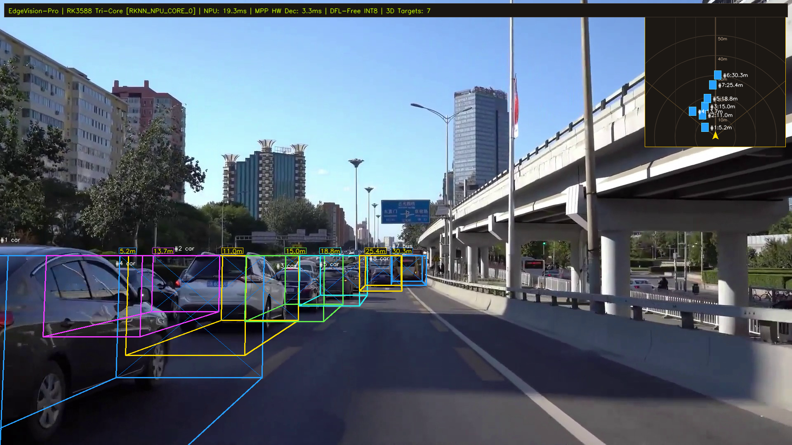

# EdgeVision RK3588: 端侧推理加速 + 端侧具身智能体

> 一块 RK3588 开发板上的两个工程方向：**把 YOLOv8 在 NPU 上压到 20.58 ms**，
> 以及**让 2B 大模型在板子上离线跑通"感知-决策-执行"闭环**。

[-blue.svg)]()
[]()
[]()
[]()
[]()
[]()

> **定位**：一块 **RK3588 EVM3588-B** 上跑通的两条线 ——
> ①**端侧推理加速**：MPP 硬解 → DFL-Free 模型 → 三核 NPU → INT8 量化掉点控制，全部有板端实测数字；
> ②**端侧具身智能体**：RKLLM + Qwen3.5-2B 纯单板离线，硬件 Tool Calling 闭环 + 快慢双系统巡检守护。
>
> **本仓库的原则：所有数字都来自真实链路，能当场复现。** 未实现的功能明确列在
> 「明确未实现」表里，不写进架构图、不写进基准表 —— 见 [AGENTS.md 工作约定 3](AGENTS.md)。

---

## 实测演示


*单帧真实推理输出：NPU 检测框 + 单目 3D 线框 + 自车坐标系 BEV 鸟瞰栅格 + 顶部吞吐/NPU 调度 HUD。
这张图来自**板端 C++ 链路**（MPP 硬解 → NPU → 后处理 → BEV 投影），不是仿真渲染。*

> **实时演示链路**：
> - **板端实时 Web 流媒体**：板端运行 `lab/w4_edgevision_preview_real`，浏览器访问 `http://<板子IP>:8080` 实时查看 DFL-Free INT8 真实检测画面与遥测 HUD。
> - **TCP 9000 边缘推流网关**：板端守护进程直推 248 字节结构体，PC 运行 [`lab/pc_client_viewer.py`](lab/pc_client_viewer.py) 实时跨机解析呈现（实测连续 800+ 帧稳态 19.2 FPS）。
> - *注：[`demo/`](demo/) 为早期免硬件环境的 PC 离线看板素材；开发板全链路实测性能以本文「板端实测基准」一节为准。*


---

## 系统架构（**已实现**的链路）

> 本图只画跑通并有实测数据的模块。规划中但**尚未实现**的部分单独列在下方「明确未实现」一节，
> 不混进架构图里 —— 见 [AGENTS.md 工作约定 3](AGENTS.md)：不许用假数据冒充结果。

### A. 视觉推理数据面（C++ 原生，板端）

```
        [ USB 摄像头 / 静态 JPEG ]
                      │
                      ▼
    ┌──────────────────────────────────────────────┐
    │  MPP 硬件 JPEG 解码 (VPU)                     │
    │  - MJPEG → NV12，直出物理连续内存             │
    │  - 实测 p50 1.03 ms，软解 7.76 ms → 7.6×      │
    │  - 9/9 图 PSNR 49.9~77.2 dB 验证一致          │
    └──────────────────┬───────────────────────────┘
                       ▼
    ┌──────────────────────────────────────────────┐
    │  NV12 → RGB888 CSC + letterbox 640×640        │
    │  - ⚠️ 当前是 CPU 定点实现（O3 后 33.58 ms）   │
    │  - RGA 硬件化是**待做项**，未实现             │
    └──────────────────┬───────────────────────────┘
                       ▼
    ┌──────────────────────────────────────────────┐
    │  RK3588 三核 NPU  (6.0 TOPS INT8)            │
    │  - rknn_set_core_mask 硬绑定 Core0/1/2        │
    │  - 3 context 真并行：59.3 FPS / 2.21×         │
    │  - 纯推理 15.95 ms（原 84ch 模型 37.19 ms）   │
    └──────────────────┬───────────────────────────┘
                       ▼
    ┌──────────────────────────────────────────────┐
    │  DFL-Free 后处理（自己做的图手术）            │
    │  - 模型里砍掉 DFL 头，解码搬到 CPU            │
    │  - 解码 + NMS：O0 3.44 ms → O3 0.62 ms        │
    └──────────────────┬───────────────────────────┘
                       ▼
    ┌──────────────────────────────────────────────┐
    │  单目 3D 反投影 + BEV 鸟瞰（纯几何，无假数据）│
    │  - 针孔模型 + 地平面假设解 X/Y/Z              │
    │  - 8 顶点 3D 线框 + 自车坐标系 BEV 栅格       │
    └──────────────────────────────────────────────┘
```

### B. 边缘智能体（Edge Agent，纯端侧离线）

```
    自然语言指令
         │
         ▼
  ┌──────────────────────────────────────────┐
  │  RKLLM 原生 C++ 推理                     │
  │  - Qwen3.5-2B W8A8 (2.8 GB)              │
  │  - 三核 NPU 协同 + A76 大核绑定          │
  │  - 完全单板离线，不依赖 PC / 云端        │
  └───────────────┬──────────────────────────┘
                  ▼
  ┌──────────────────────────────────────────┐
  │  ReAct 工具调用循环（最多 5 步）         │
  │  - XML tool_call 解析 + JSON 回填        │
  └───────────────┬──────────────────────────┘
                  ▼
  ┌──────────────────────────────────────────┐
  │  硬件工具层                              │
  │  get_system_health  温区0/2+NPU/内存     │
  │  get_vision_telemetry 9000 端口 248B 帧  │
  │  get_patrol_events  巡检事件黑匣子       │
  │  get_led_status     只读灯态             │
  │  control_led        控灯（白名单+回读）  │
  └──────────────────────────────────────────┘

  旁路：快慢双系统巡检守护（5s 周期，快层不加载 LLM）
        → 状态机 + 迟滞 → 真实控灯 + 事件落盘 → Agent 读事件研判
```

---

## 关键技术点（每条都有实测数字）

1. **DFL-Free 图手术：把 YOLOv8 的检测头从图里搬掉**
   把 `yolov8n.onnx`（262 节点，1 输出 84ch）切成 2 输出（`raw_box` 64ch + `cls_sig` 80ch），
   整个 DFL 解码链（Transpose/Softmax/Reshape）从计算图消失 —— 原模型 **49% 的时间（18.44 ms）**就耗在这三个 CPU 回退算子上。
   - 数值等价已证明：box `max|Δ| = 0.000122 px`、cls `max|Δ| = 0`（float32 精度极限）
   - 纯推理 **37.19 → 15.95 ms（−57%）**，模型 INT8 体积 **6.22 → 4.34 MB（−30.2%）**，单帧全链路 **37.19 → 20.58 ms（+81% FPS）**
   - ⚠️ 体积口径别混：FP32 ONNX 原图 12.2 MB → INT8 84ch 6.22 MB（量化，−49.2%）→ INT8 DFL-Free 4.34 MB（图手术，−30.2%），跨两步不能合成一个减法

2. **INT8 量化掉点控制：用真 mAP 说话，不用余弦相似度凑**
   换掉合成色块校准集（导致 cls 分支塌缩成常数 `sigmoid(0) = 0.5`）后重建真实校准集，
   在 COCO128（128 张 / 929 GT / 71 类）上跑真 mAP@0.5：**FP32 0.6087 → INT8 0.6002，绝对掉点 0.85 个点（−1.4%）**。
   - ⚠️ 局限：COCO128 是 YOLOv8n 的训练子集，绝对 mAP 偏乐观；但 FP32/INT8 用同一批图，"见过"因素两边抵消，**相对掉点成立**
   - 用 **1.4% 的精度换 45% 的延迟下降**

3. **RK3588 三核 NPU 真并行（不是理论值）**
   `rknn_set_core_mask` 硬绑定 3 个独立 context，实测 **59.3 FPS / 2.21×**（单核 37.19 ms → 3 路 40.8 ms/路）。
   - 诚实结论：**不是线性 3×**，三核各只跑到 49% 负载，NPU 没被喂饱

4. **编译优化：一个 20 多天没人发现的坑**
   构建系统里 `CMAKE_BUILD_TYPE` 一直是**空的**，`CXX_FLAGS` 里**一个 `-O` 都没有** —— 此前所有 CPU 数字都是 -O0 的悲观值。
   - 修复后（`taskset -c 6` 绑大核，同一张图，O0/O3 各 5 次）：**CSC 52.016 → 33.583 ms（1.549×）**，
     **全链路 76.928 → 55.836 ms（−27.4%，13.0 → 17.9 FPS）**
   - 两个"不该变"的对照组同时成立（MPP 硬解 +5.8%、letterbox +3.2%）→ 证明加速来自编译优化而非测量漂移

5. **MPP 硬解 JPEG 落地 + 硬编负结论**
   硬解 **p50 1.03 ms vs 软解 7.76 ms（7.6×）**，200/200 有效帧。
   硬编也完整实现并验证正确（9 图 Y-PSNR 42.46 dB），但**实测比软编还慢**：
   1280×720 `7.24 vs 6.65 ms`、分辨率 64×64~960×540 **全部档位都更慢**、4 路并行软编快 1.88×。
   唯一优势是 CPU 占用 `8.2% vs 99.7%`，单路 30fps 场景不划算 → **已从路线图划掉**。
   > 负结论也是结论，比硬凑一个"快了 5%"有价值。

6. **端侧大模型 Tools Calling 具身闭环**
   Qwen3.5-2B W8A8 跑在 NPU 上，纯单板离线。一条自然语言可跑完 **巡检 → 研判 → 执行 → 汇报**：
   实测端到端 **106.5~112.2 s**（三次测量含 123.9s 长尾）、连续调用 **4~5 个不同工具**、Observation **20~29 条**全合法 JSON、中文研判 **1315~1350 字**。

7. **快慢双系统巡检守护（快层不加载 LLM）**
   5s 周期状态机 + 迟滞（person 连续 2 次 ≥0.5 进告警、连续 5 次无目标恢复；zone0 >75°C 进、<70°C 连续 3 次出）。
   快层刻意**不用 LLM**：NPU 竞争、时延、可靠性三条理由；LLM 留给慢层消费 `llm_pending.jsonl`。
   真实闪灯验收：告警期占空比 **49.7% vs heartbeat 基线 20.0%（+29.7pp）**，6s 内翻转 73 次。

8. **把 Agent 的错误结论定位到感知层（最有价值的一次 debug）**
   演示判 PASS，但翻 trace 发现 Agent 汇报"LED 熄灭导致过热保护被抑制"，而灯**正在爆闪**。
   根因不是模型幻觉，是工具 `get_led_current_mode()` 单点采样撞上 100 ms 爆闪灭相 —— **周期性物理量用瞬时单点采样定性 = 混叠**。
   - 另两个同类修复：模型缺领域常识（把 49°C 说成"永久损坏风险"）→ sys_prompt 补世界知识；
     `--no-led` 下模型把 4 种模式挨个试一遍 → 加 `hint` 后 **4 次 → 1 次**
   - **方法论**：Agent 给出离谱结论时，先分层定位"模型幻觉 vs 感知层喂错数据"，再谈调 prompt

9. **硬件工具层可靠性（不是 demo 级）**
   `control_led` 白名单 + 逐次写检查 + 写后回读比对；非法模式**不碰 sysfs** 直接拒绝；
   视觉工具收满 248 B 定长帧、区分 `online/offline/timeout/partial_frame/malformed_frame`、双采样比 `frame_id` 判新鲜度。
   - 回归测试 **12 用例全绿**，含故障注入（停 `edgevision.service` 验视觉离线，`finally` 自动恢复）

---

## 板端实测基准（EVM3588-B，全部来自真实链路）

> 口径说明：以下均为 **RK3588 物理开发板**实测，不是仿真、不是理论值、不是"预估"。
> 每条的测量方法、样本量、局限见 [`docs/BENCHMARKS.md`](docs/BENCHMARKS.md)；
> 不同口径（纯推理 / 全周期 / 全链路）已分开列出，不混在一张表里。

### 推理与后处理

| 指标 | 优化前 | 优化后 | 提升 | 口径 |
|---|---:|---:|---:|---|
| 纯推理 `rknn_run` | 37.19 ms | **15.95 ms** | −57.1% | 200 次，单核 |
| DFL 解码 + NMS | 3.09 ms | **0.62 ms**（O3） | 5.5× | O0/O3 对照，`taskset -c 6` |
| 单帧全链路 | 37.19 ms / 26.9 FPS | **20.58 ms / 48.6 FPS** | −44.7% / +81% | 纯推理+IO+后处理 |
| 三核并行聚合 | — | **59.3 FPS（2.21×）** | — | 3 个独立 context 绑 3 核 |

### 图像处理（生产链路 `edgevision_pro_main`，O0 vs O3）

| 阶段 | O0 | O3 | 变化 | 说明 |
|---|---:|---:|---:|---|
| MPP 硬解 | 1.250 ms | 1.322 ms | +5.8% | **对照组①**：硬件层不该变 ✔ |
| **CPU CSC** | **52.016 ms** | **33.583 ms** | **1.549×** | 定点 BT.601，最大瓶颈 |
| letterbox | 1.184 ms | 1.222 ms | +3.2% | **对照组②**：OpenCV 预编译库动不了 ✔ |
| NPU + DFL | 22.480 ms | 19.708 ms | −2.77 ms | 与 bench 口径吻合 |
| **全链路** | **76.928 ms** | **55.836 ms** | **−27.4%** | 13.0 → 17.9 FPS |

### 其余模块

| 指标 | 数值 | 口径 / 局限 |
|---|---|---|
| MPP 硬解 MJPG | **p50 1.03 ms** vs 软解 7.76 ms（7.6×） | 200/200 有效帧，9 图 PSNR 49.9~77.2 dB |
| INT8 量化掉点 | **mAP@0.5 0.6087 → 0.6002（−0.85 点 / −1.4%）** | COCO128 是训练子集，绝对 mAP 偏乐观，相对掉点成立 |
| 模型体积 | INT8 **6.22 MB → 4.34 MB（−30.2%）**；FP32 ONNX 12.2 MB → INT8 6.22 MB（−49.2%） | 两步分开算，别合成 12.2→4.34 |
| 端侧 Agent 端到端 | **106.5~112.2 s**（含 123.9s 长尾）/ 4~5 个工具 / **1315~1350 字** | Qwen3.5-2B W8A8，单板离线，三次独立测量 |
| 巡检守护告警闪灯 | 占空比 **49.7%** vs 基线 20.0%（+29.7pp） | 0.02 s 采样，6 s / 300 点 |
| Agent 回归测试 | **12/12 通过** | 含故障注入，两次独立全量 |

### 明确未实现（不要对外宣传）

| 项目 | 状态 |
|---|---|
| RGA 硬件 CSC / 缩放 | **未实现**，当前是 CPU 定点实现 |
| DMA-BUF / 全链路零拷贝 | **未实现**，`rknn_inputs_set` 走普通内存拷贝 |
| RTSP / WebRTC 推流 | **未实现**，实际是 TCP 9000 自定义 248 B 定长帧协议 |
| H.264 / H.265 硬解 | **未实现**，MPP 只做了 MJPEG |
| ByteTrack 进 C++ 网关 | **未实现**，`track/` 下只有 Python 仿真 |
| 整机功耗 | **未测**，无功率计 |
| MPP 硬编 JPEG | **已实现但已否掉**，实测比软编慢（见关键技术点 5） |

---

## 快速开始

### 1. 板端 C++ 编译（**在板子上原生编译**，别交叉编译）

板上是 Debian 11 / glibc 2.31，Ubuntu 22.04 交叉编译出来的二进制会因 glibc 2.35 起不来。

```bash
git clone <this-repo> && cd edgevision-rk3588/deploy/cpp
mkdir -p build_native && cd build_native
cmake .. -DCROSS_COMPILE_RK3588=ON        # 默认就是 Release (-O3)，别再手写 -O0
make -j4
```

> ⚠️ 构建时会打印配置摘要。**如果摘要里没有 `-O`，说明优化没生效** —— 本项目就踩过这个坑
> （见关键技术点 4 与 `docs/TROUBLESHOOTING.md` 第 24 条）。

跑一帧真实推理（需要一张 JPEG 和模型）：

```bash
./edgevision_pro /root/edgevision/data/calib_v2/real_000.jpg
```

### 2. 端侧 Agent（纯单板离线）

```bash
cd /root/rkllm_deploy
./rkllm_embodied_agent_p0                      # 进 REPL，可多轮对话
./rkllm_embodied_agent_p0 "板子现在温度多少"    # 单轮
./rkllm_embodied_agent_p0 --no-led "查一下巡检告警"  # 只读模式（LED 归守护进程管）
```

### 3. Agent 回归测试（PC 侧发起，SSH 驱动板上二进制）

板子内网 IP 不入库，用环境变量或 `--host` 传（三个脚本都支持）：

```bash
export EDGEVISION_BOARD_HOST=<board-ip>     # Windows: set EDGEVISION_BOARD_HOST=<board-ip>
python lab/agent_regression_test.py --with-faults --timeout 240 --out-dir _test_results
# 12 用例，含故障注入；--only T03 只跑指定用例；--list 列出全部用例
```

### 4. 两幕多步演示（守护真闪灯 + Agent 研判汇报）

```bash
python lab/agent_multistep_demo.py --out-dir _test_results
```

---

## 深度文档与指南

| 文档 | 内容 | 什么时候看 |
|---|---|---|
| [`docs/CURRENT_STATUS.md`](docs/CURRENT_STATUS.md) | 现在能干什么 + 下一步 | **接手先看这份** |
| [`docs/BENCHMARKS.md`](docs/BENCHMARKS.md) | 全部性能/精度实测，含口径与局限 | 想知道数字怎么来的 |
| [`docs/TROUBLESHOOTING.md`](docs/TROUBLESHOOTING.md) | 25 条踩坑记录：现象 → 排查 → 根因 → 解法 | **面试素材主要来源** |
| [`docs/AGENT_MULTISTEP_DEMO.md`](docs/AGENT_MULTISTEP_DEMO.md) | 两幕演示设计 + 3 个缺陷复盘 + 面试讲法 | 想讲 Agent 这条线 |
| [`docs/PATROL_DAEMON_DESIGN.md`](docs/PATROL_DAEMON_DESIGN.md) | 快慢双系统设计 + 为什么快层不用 LLM | 想讲架构取舍 |
| [`docs/AGENT_TEST_PLAN.md`](docs/AGENT_TEST_PLAN.md) | 12 用例表 + 指标口径 + 故障注入协议 | 想讲测试 |
| [`docs/ONBOARD_QUICKSTART.md`](docs/ONBOARD_QUICKSTART.md) | 板卡到货 1 小时通关 | 换板/复现环境 |
| [`AGENTS.md`](AGENTS.md) | 项目总纲与工作约定 | 了解这个仓库怎么协作 |
